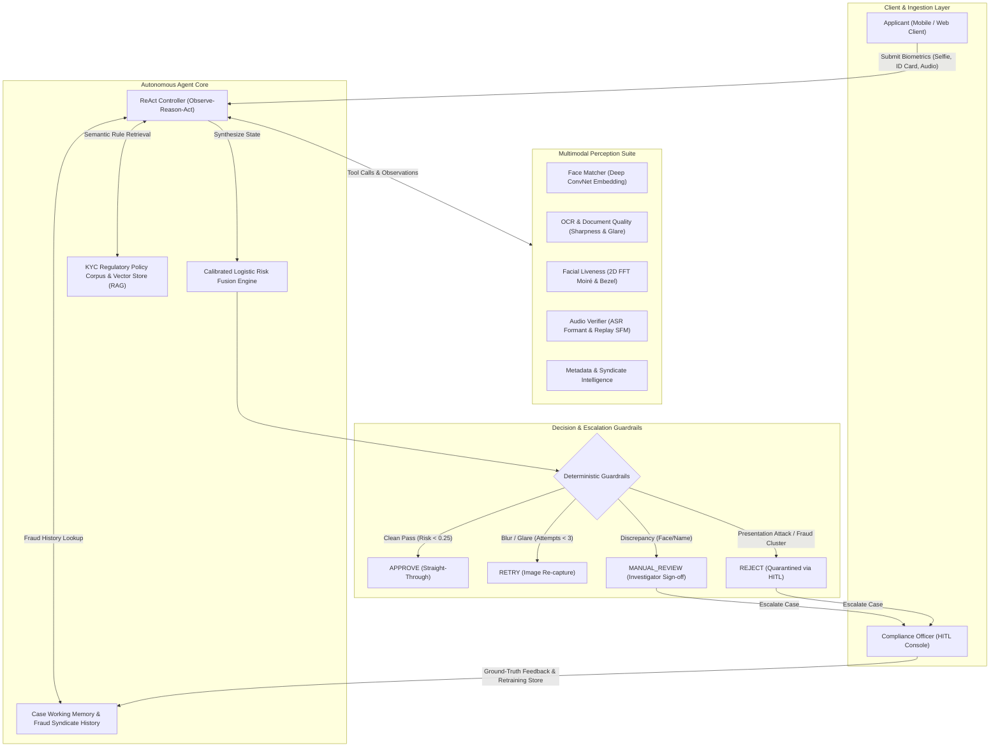
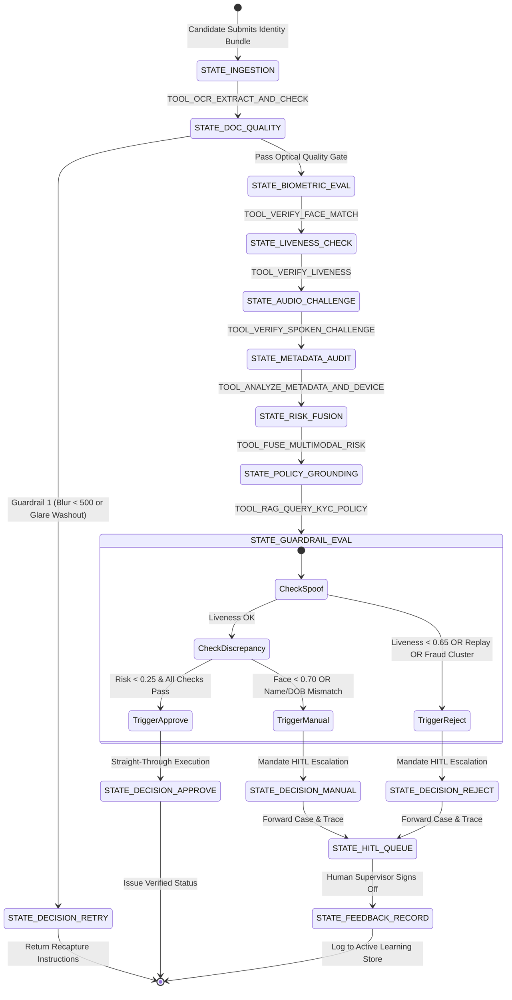

# Agent Architecture & State-Action Diagrams (Deliverable D5)

**Project ID:** HSR-AGAI-029 (Agentic Multimodal eKYC Verification, Risk Fusion and Escalation Agent)  
**Deliverable:** D5 – Agent Architecture and State-Action Diagram  

---

## 1. System High-Level Architecture Diagram

---

## 2. ReAct Agent State-Action Finite State Machine (FSM)

---

## 3. Labelled Tool Registry

| Tool Identifier | Input Parameters | Output Artifacts | Governing Policy |
|---|---|---|---|
| `TOOL_OCR_EXTRACT_AND_CHECK` | `card_image_path`, `form_data` | OCR fields, blur metric, glare ratio, text consistency score | `POL-001`, `POL-004` |
| `TOOL_VERIFY_FACE_MATCH` | `selfie_image_path`, `card_image_path` | Cosine similarity, skin reflectance distance, match verdict | `POL-003` |
| `TOOL_VERIFY_LIVENESS` | `selfie_image_path` | 2D FFT moiré peak, device bezel detection, calibrated liveness score | `POL-002` |
| `TOOL_VERIFY_SPOKEN_CHALLENGE` | `audio_path`, `expected_digits` | Digit Error Rate (DER), spectral flatness, acoustic replay probability | `POL-005` |
| `TOOL_ANALYZE_METADATA_AND_DEVICE` | `applicant_metadata` | Known fraud cluster collision, hardware velocity count, metadata risk | `POL-006` |
| `TOOL_RAG_QUERY_KYC_POLICY` | `semantic_query_string` | Top-k relevant KYC runbook rules with authoritative citations | All (`POL-001` - `POL-006`) |
| `TOOL_QUERY_CASE_MEMORY` | `device_id`, `id_number` | Working memory history, previous attempts, repeat rejections | Fraud Detection Runbook |
| `TOOL_FUSE_MULTIMODAL_RISK` | `perception_bundle` | Calibrated overall risk score ($R \in [0.0, 1.0]$), risk tier, breakdown matrix | Banking Risk Standard |
| `TOOL_EMIT_DECISION` | `decision`, `escalate`, `rationale` | Final terminal action (`APPROVE`, `RETRY`, `MANUAL_REVIEW`, `REJECT`) | Executive Policy |

